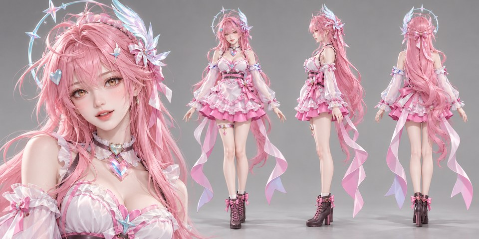
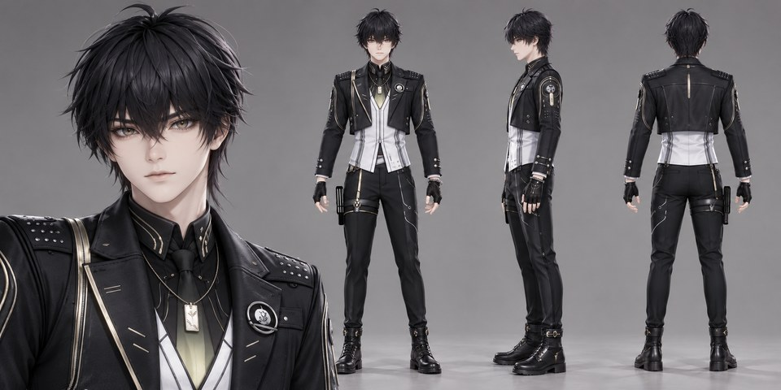
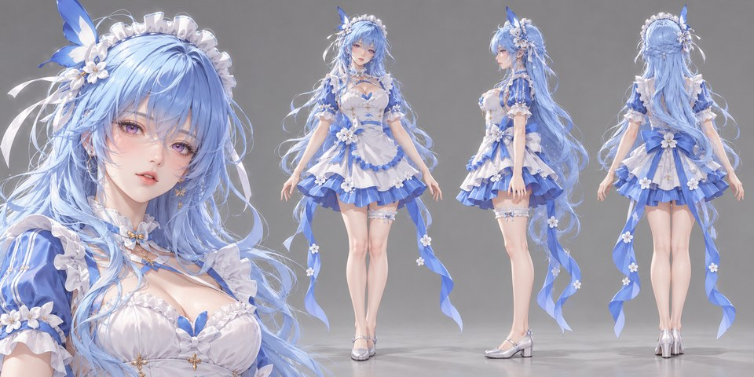
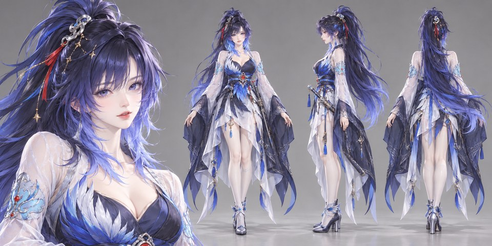
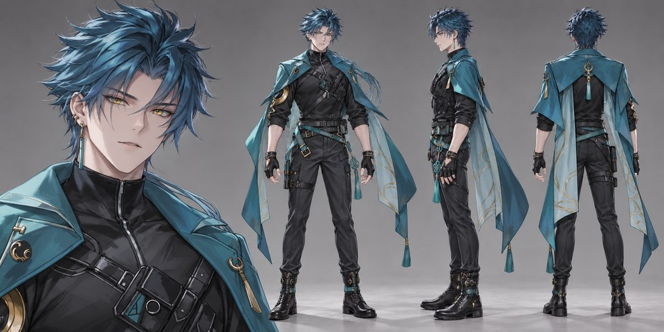
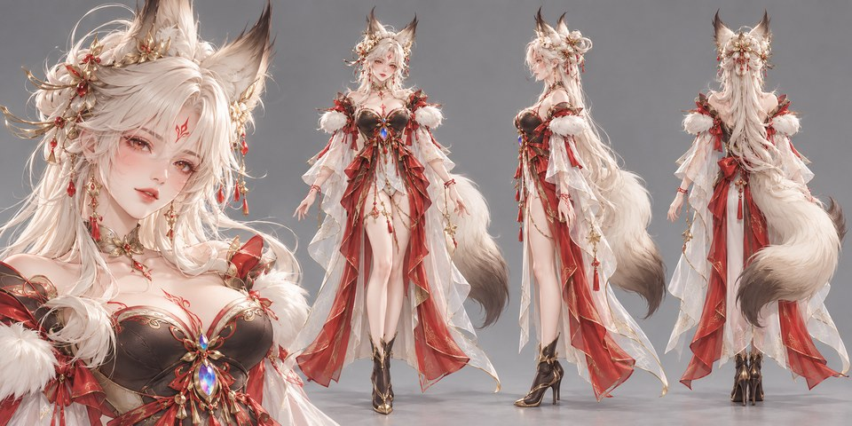

# draw_role_form_mingchao_acg

参考角色原图，生成统一的半写实 ACG / CG 角色设定图。

默认一张图包含 **左侧头肩特写 + 右侧正面、严格侧面、背面三张全身图**，适合整理同人动画前期角色资产。保留参考人物的身份、服装与配色，并以实际图片锚点统一画风。

## 成品示例

以下为本项目实际生成的角色设定图，点击预览可查看 PNG 原图。

| 示例 | 示例 |
| --- | --- |
| **爱弥斯**<br>[](examples/爱弥斯.png) | **男漂泊者**<br>[](examples/男漂泊者.png) |
| **守岸人**<br>[](examples/守岸人.png) | **秧秧**<br>[](examples/秧秧.png) |
| **忌炎**<br>[](examples/忌炎.png) | **心月狐**<br>[](examples/心月狐.png) |

[查看全部 24 张角色示例](examples/README.md)

## 这个技能做什么

- 使用新角色参考决定脸、发型、体型、服装、配饰与主配色。
- 使用女性或男性风格锚点统一材质、光照与排版，不把锚点人物的脸或服装移植到新角色上。
- 采用柔和中性棚拍光、中灰背景、接触阴影，以及清晰的头发、布料、皮革和金属细节。
- 三视图等高、脚底对齐，头饰与鞋履完整入画；人物自然站立，不默认攻击姿势。
- 对原图没有展示的背面或鞋履谨慎补全，并说明补全范围；补全部分不当作官方设定。

用户临时指定的新风格、姿势或背景优先于默认值。完整规则见 [SKILL.md](SKILL.md)。

## 安装

将整个仓库下载为 ZIP 后解压，把包含 `SKILL.md` 的这一层文件夹命名为 `draw_role_form_mingchao_acg`，放入 Codex 的用户技能目录：

- Windows：`%USERPROFILE%\.codex\skills\draw_role_form_mingchao_acg`
- macOS / Linux：`~/.codex/skills/draw_role_form_mingchao_acg`

也可以使用 Git：

```powershell
git clone https://github.com/wek486/role_image.git "$env:USERPROFILE\.codex\skills\draw_role_form_mingchao_acg"
```

目标目录若已有同名技能，请先保存自己的修改，再更新需要的文件。安装后新开一个 Codex 对话，确认技能出现在可用列表中。

必须保留 `assets` 文件夹：两个锚点是技能工作所需的实际视觉参考。`examples` 仅用于展示，不是每次生成都要上传的参考集合。

## 使用

上传一张角色参考图，在支持技能与内置图片生成工具的 Codex 会话中输入：

```text
使用 $draw_role_form_mingchao_acg，把这张角色参考图生成同系列半写实 CG 角色设定图。
```

已经建立角色上下文后，也可以直接说“这个也生成”。半身参考允许谨慎补全；有全身、背面或鞋履参考时，一起提供可提高一致性。

运行时需要会话提供内置 `image_gen` 工具；是否可用取决于实际环境。本技能本身不包含独立生成程序，不调用外部付费 API，也不要求你提供 API key。宿主如果提供 `imagegen` 通用技能，应同时遵循其工具使用说明。

默认先生成一版，最终图保存为参考图所在角色目录下的 `半写实角色设定-v1.png`；已有文件则递增版本号，不覆盖。默认不额外保存提示词或日志。

## 文件结构

```text
draw_role_form_mingchao_acg/
├── SKILL.md
├── agents/
│   └── openai.yaml
├── assets/
│   ├── approved-female.png
│   └── series-male.png
└── examples/
    ├── README.md
    ├── *.png
    └── previews/
        └── *.jpg
```

## 示例说明

示例选自本地动画项目已有的 AI 生成角色设定成品；包括鸣潮角色，以及用于展示参考图转换能力的其他角色与敌人样例。未发布第三方原始参考插画、浏览器截图、个人登录信息或项目剧情资料。

这是同人创作工作流，非官方角色资料。角色名称、原作设计及相关标识的权利归相应权利方；示例不代表官方设定、授权背书或对角色权利的转授。
